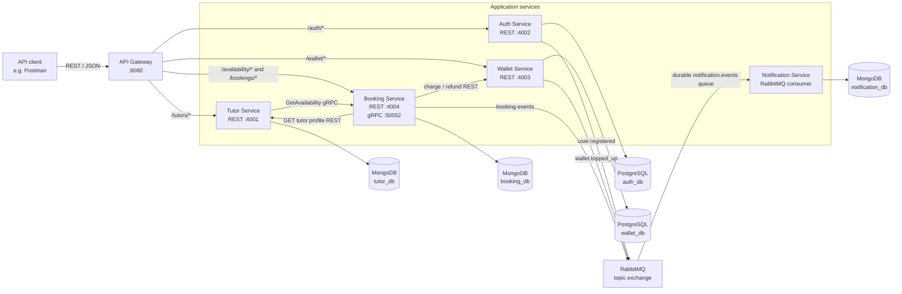

# Tutor Matcher — Current Project Architecture

> This document describes the implementation in this repository. It is a backend microservice demo, not the broader target architecture or feature set described in the project proposal.

## 1. Overview

Tutor Matcher is an online tutoring marketplace backend. API clients (the included Postman collections are examples) send REST requests to an API Gateway. The gateway routes requests to independently runnable Node.js services. Tutor and Booking also communicate over gRPC, while Auth, Booking, and Wallet publish events for the Notification service through RabbitMQ.

The current demo supports account registration and login, tutor discovery and profiles, availability management, booking and wallet payment, mock wallet top-ups, booking cancellation and refunds, and asynchronous notification records. There is no web frontend in this repository.

## 2. Architecture at a Glance

An arrow represents a request or event sent in the arrow's direction. The database engines shown are shared local containers in Docker Compose; each service uses its own logical database and owns its data.

## 3. Services and Responsibilities

| Component | Interface | Owns | Persistence |
| --- | --- | --- | --- |
| **API Gateway** | REST, port `8080` | Public routing, JWT verification, and forwarding authenticated user identity | None |
| **Auth Service** | REST, port `4002` | Account registration, password verification, and JWT issuance | PostgreSQL `auth_db` |
| **Tutor Service** | REST, port `4001` | Tutor profiles, publication status, subject offerings, rates, and tutor search | MongoDB `tutor_db` |
| **Booking Service** | REST, port `4004`; gRPC, port `50052` | Availability slots, booking lifecycle, booking price and cancellation state | MongoDB `booking_db` |
| **Wallet Service** | REST, port `4003` | Wallet balances, top-ups, lesson charges, refunds, and transaction history | PostgreSQL `wallet_db` |
| **Notification Service** | RabbitMQ consumer; no public HTTP API | Event-to-message rendering and delivery records | MongoDB `notification_db` |

Each service has its own package manifest and lockfile. Services communicate through their APIs or events; they do not read another service's database directly. The service boundaries are separate processes and Docker containers in Compose, while MongoDB, PostgreSQL, and RabbitMQ are shared infrastructure instances in the local stack.

### API Gateway and authentication

The Gateway routes `/auth/*`, `/tutors/*`, `/availability/*`, `/bookings/*`, and `/wallet/*` to their owning services. Registration and login are public. Tutor reads are public; writes to tutors, availability, bookings, and wallet routes require a valid Bearer token. The Gateway verifies the JWT and forwards the user's ID and email in `x-user-id` and `x-user-email` headers.

Auth stores password hashes (bcrypt) in PostgreSQL and issues JWTs with a two-hour lifetime. The token subject (`sub`) is the account ID. The current account model does not define student, tutor, or admin role claims; there is no separate admin authorization workflow in this codebase.

### Tutor and Booking

Tutor owns tutor profiles and embedded subject offerings. Tutor search filters to `PUBLISHED` profiles and supports subject, keyword, and maximum-rate filters. A profile response includes availability fetched from Booking using the shared contract in [`proto/booking.proto`](proto/booking.proto). If Booking cannot respond within the configured deadline, Tutor returns the profile with an empty availability list and an `availabilityUnavailable` indicator.

Booking owns dated availability slots and bookings. Slots refer to a tutor by ID; Booking does not query Tutor's database. The REST API supports the main marketplace workflow. The gRPC API provides `CreateSlot`, `GetAvailability`, `UpdateSlot`, and `DeleteSlot` for availability operations.

### Wallet

Wallet is the only service that changes wallet balances. PostgreSQL transactions lock a wallet row while applying a movement and write a transaction-history record. The internal charge and refund endpoints are called by Booking; they are not part of the public gateway routes.

### Notification

Notification consumes events and creates a delivery record containing the event ID, recipients, and rendered message. In this demo, “send” is written to the service log; an email or push provider is not integrated.

## 4. Main Request and Event Flows

### Discover a tutor and view availability

1. A client requests tutor search or a profile through the Gateway.
2. Tutor reads its own MongoDB data and returns matching public profiles.
3. For a profile request, Tutor calls Booking's `GetAvailability` gRPC method and combines the slot list with the profile.

### Create and pay for a booking

1. An authenticated client creates a booking with a tutor, subject, and distinct slot IDs.
2. Booking asks Tutor for the profile, verifies that the tutor is published and offers the requested subject, and checks that the selected slots belong to the tutor and are consecutive 30-minute slots.
3. Booking reserves the slots and stores a `PAYMENT_DUE` booking. The amount is calculated from the subject's hourly rate and the number of half-hour slots.
4. The client pays through Booking. Booking calls Wallet's internal charge endpoint; Wallet checks and updates the balance in a PostgreSQL transaction.
5. On successful payment, Booking changes the booking to `CONFIRMED` and publishes `booking.confirmed`. An insufficient balance leaves the booking payment-due.

### Top up the wallet

1. The client starts a top-up with a positive whole-baht amount.
2. Wallet stores a pending top-up and returns a placeholder PromptPay payload.
3. The client calls the confirmation endpoint, which simulates the payment provider. Wallet marks the top-up paid and credits the balance in one database transaction, then publishes `wallet.topped_up`.

There is no live PromptPay connection or real QR-code payment flow in this repository.

### Cancel a booking

Booking cancels a payment-due or confirmed booking and releases its held slots. For a confirmed booking it requests a wallet refund first: the current rule refunds the full amount at least 24 hours before the start, otherwise half (rounded down). The cancelled booking and refund amount are then published in `booking.cancelled`.

### Deliver notifications asynchronously

Auth, Wallet, and Booking publish persistent messages to the durable `tutor-matcher.events` topic exchange. Notification consumes the durable `notification.events` queue, renders supported event types, and records each event ID with a uniqueness constraint so a redelivered event is not recorded twice. When RabbitMQ is available, the queue can buffer events while the consumer is offline. Publisher errors are logged and do not reverse the business operation.

Events currently produced are:

| Event | Produced by | Trigger |
| --- | --- | --- |
| `user.registered` | Auth | Account registration |
| `wallet.topped_up` | Wallet | Successful top-up confirmation |
| `booking.confirmed` | Booking | Successful booking payment |
| `booking.cancelled` | Booking | Booking cancellation |

## 5. Data Ownership and Consistency

| Data | Owner | Notes |
| --- | --- | --- |
| Accounts and password hashes | Auth | UUID account IDs; unique email addresses |
| Tutor profiles and subject offerings | Tutor | Subject names, descriptions, rates, and profile publication status |
| Availability and bookings | Booking | Availability slots use tutor IDs as references; booking statuses include `PAYMENT_DUE`, `CONFIRMED`, and `CANCELLED` |
| Balances and transactions | Wallet | Amounts are stored as whole baht; transactions record the resulting balance and a reference |
| Notification deliveries | Notification | `eventId` is unique to support duplicate-event handling |

Financial changes are transactional within Wallet. Charge and refund requests use the booking ID as a transaction reference, and the database enforces uniqueness by movement type and reference so retries do not apply a second charge or refund. Top-up confirmation locks the top-up row and avoids crediting an already-paid top-up again.

Booking and Wallet use different databases and communicate synchronously over REST for charges and refunds. Their state changes are therefore not one cross-service database transaction; idempotent wallet operations allow a retry to recover the same financial result. Notifications are asynchronous and are not part of the booking or wallet transaction.

## 6. Runtime and Repository Layout

The root [`compose.yaml`](compose.yaml) defines the local stack. It builds the API Gateway and five domain/worker services, and starts MongoDB, PostgreSQL, RabbitMQ, and Adminer. Only the Gateway is the application entry point exposed to API clients (`127.0.0.1:8080`); database and RabbitMQ management ports are bound to loopback for local development. PostgreSQL hosts `auth_db` and `wallet_db`; MongoDB hosts `tutor_db`, `booking_db`, and `notification_db`.

| Path | Contents |
| --- | --- |
| `api-gateway/` | REST routing and JWT verification |
| `auth-service/` | Account API and PostgreSQL access |
| `tutor-service/` | Tutor API, search, and gRPC client for availability |
| `booking-service/` | Booking REST API, availability gRPC server, and service clients |
| `wallet-service/` | Public wallet API and internal booking charge/refund API |
| `notification-service/` | RabbitMQ consumer and delivery records |
| `proto/booking.proto` | Shared Tutor-to-Booking gRPC contract |
| `docker/postgres-init.sql` | Local PostgreSQL database initialization |
| `postman/` | REST demo collections and Booking gRPC request examples |

## 7. Current Scope Boundaries

The repository implements a focused service demo rather than the full Tutor Matcher product proposal. In particular, it does not currently contain:

- A student, tutor, or admin web application.
- Tutor application review or an admin listing-approval workflow. Tutor status is a profile field, not an implemented review process.
- Online meeting provisioning, attendance tracking, or lesson completion.
- Reviews, moderation, payment disputes, or payouts.
- Real PromptPay, bank payout, email, or other external-provider integrations. Top-up confirmation is simulated, and notification delivery is logged and recorded locally.

These are product capabilities from the broader proposal, not components or flows implemented by this repository today.
