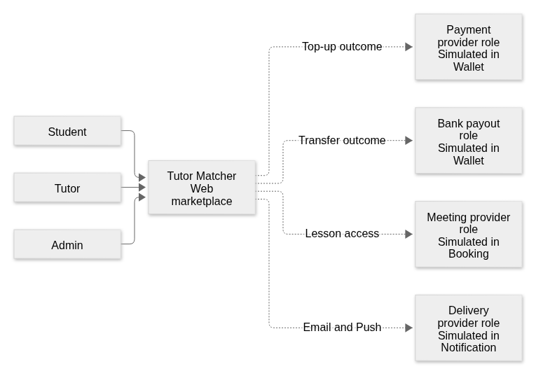
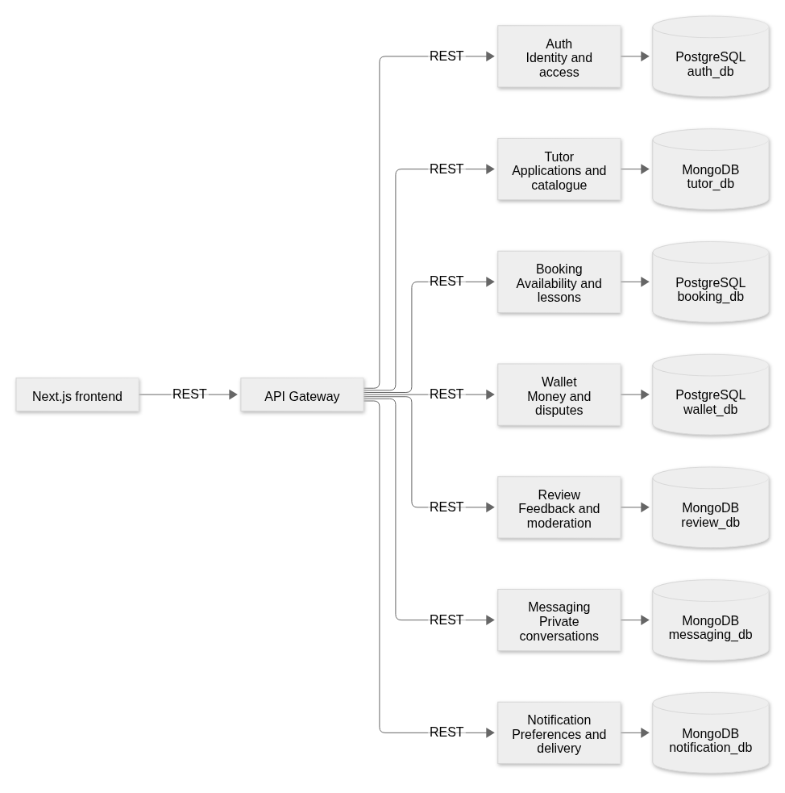
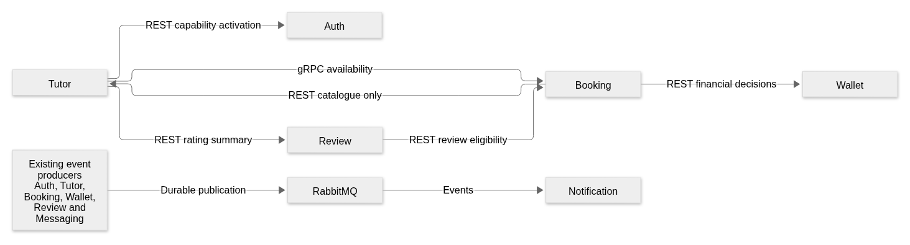
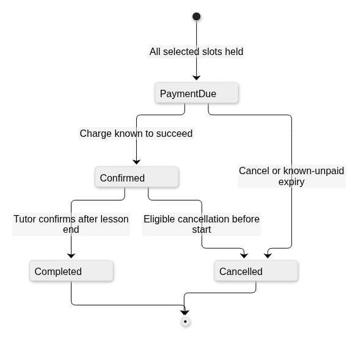
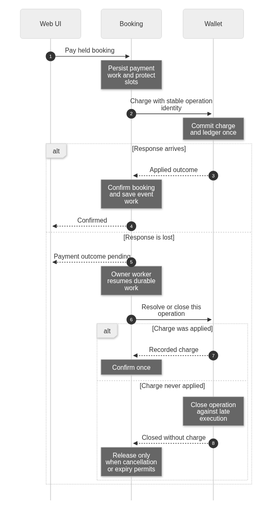
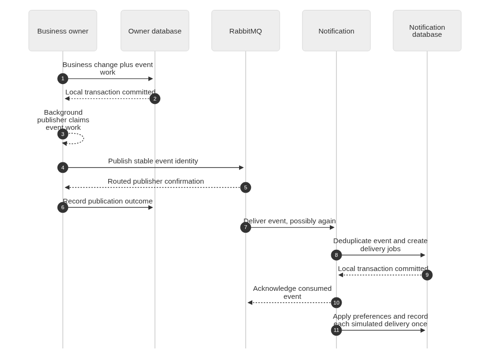
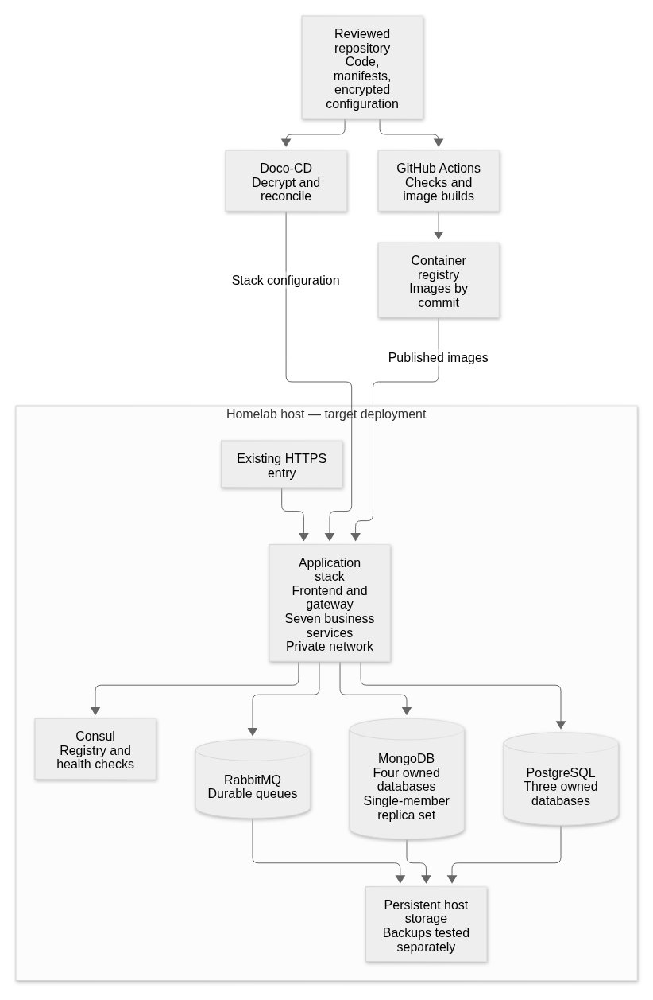
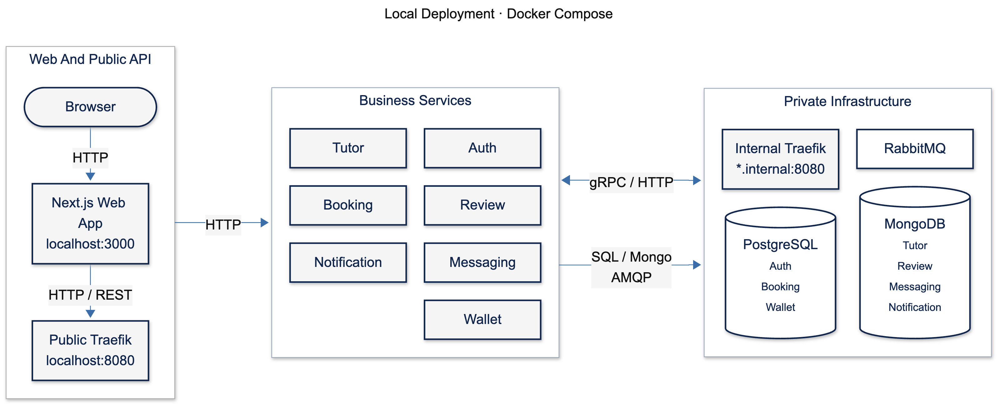
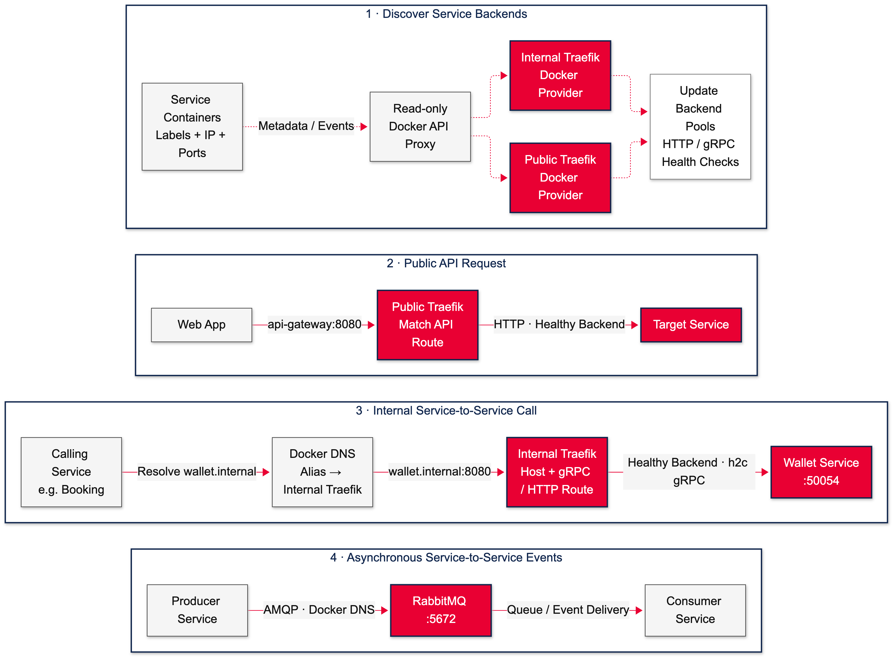

# Tutor Matcher rendered design views

The deployment SVG/PNG assets predate [ADR-0029](../adr/0029-traefik-swarm-discovery.md) and still show the superseded Consul topology. They are historical images, not renderings of the current Traefik/Swarm source. Use the current [system-design deployment view](../system-design.md#deployment-and-operational-limits) and [hosted manifest](../../infra/hosted/README.md) until the rendered images are regenerated and checked.
These views are generated from the Mermaid blocks in the [accepted system design](../system-design.md).
That document is the editable source. Regenerate these assets when a source diagram changes.
The images describe the target design, not the currently deployed or implemented system.

All seven diagrams were parsed and rendered locally with Mermaid 12.3.0 and Google Chrome 156.0.8078.79 on 6 November 2026.
The rendered images were visually inspected for readable labels, numbers, and layout. PNG previews preserve labels in image viewers that handle SVG differently.
SVG copies retain scalable output for slides. These checks do not establish runtime correctness or successful deployment.

## System context

The provider boxes describe logical roles simulated inside their owners. They are not four additional live external services.

[Scalable SVG](assets/system-context.svg)

## Containers and stores

Booking owns a PostgreSQL database separate from Auth and Wallet. Tutor, Review, Messaging, and Notification each own a MongoDB database.

[Scalable SVG](assets/containers.svg)

## Collaborations

The producer box groups existing services. The collaboration view now labels gRPC domain calls, including catalogue, financial, review, identity and reminder work. Gateway REST remains separate.

[Scalable SVG](assets/collaboration.svg)

## Booking lifecycle

The four business states remain separate from pending technical operation state. A lost response does not prove financial failure.

[Scalable SVG](assets/booking-states.svg)

## Payment recovery

The sequence names the Wallet gRPC calls. Recovery resolves an applied charge or closes an unexecuted operation against late execution before protected slots can be released.

[Scalable SVG](assets/payment-recovery.svg)

## Notification recovery

Producers retain event work with their business change. Notification accepts durable jobs before acknowledging events and records simulated delivery effects once.

[Scalable SVG](assets/notification-recovery.svg)

## Hosted deployment

The hosted target retains Swarm/Doco-CD and persistent storage. A single-member MongoDB replica set supplies transaction support without database failover.

[Scalable SVG](assets/deployment.svg)

## Local deployment

Docker Compose deployment with public and internal Traefik routing.

[Mermaid source](mermaid/local-deployment.mmd)

## Service discovery

Service discovery for public API routing, internal service calls, and asynchronous events.

[Mermaid source](mermaid/service-discovery.mmd)
