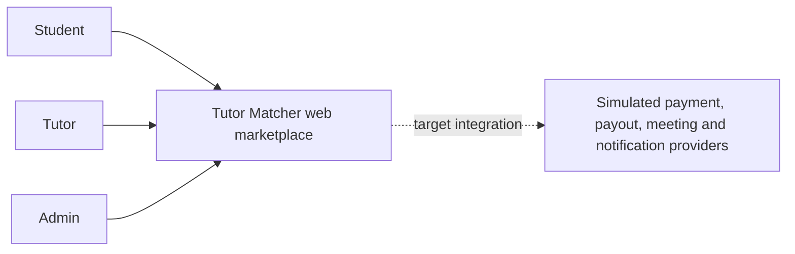
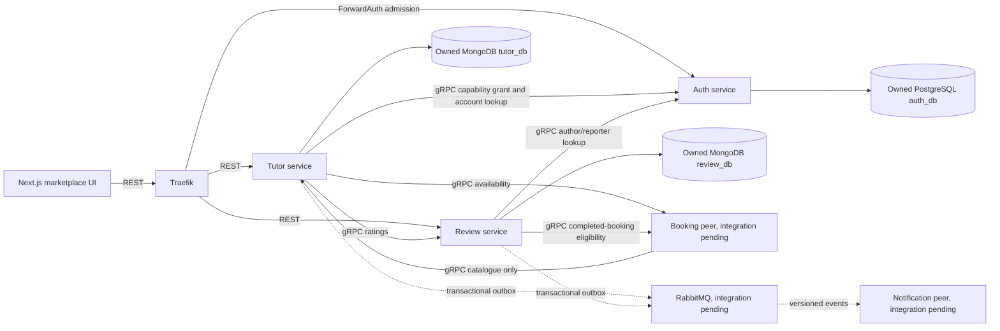

# Tutor and Review architecture contribution

## Goals, constraints and decisions

I split Tutor's catalogue from Booking's slots so Booking can validate an offering without calling a public profile that calls Booking back. Tutor's catalogue RPC reads its own approved listing and subject snapshot. Discovery separately batches Booking availability and Review ratings before sorting and pagination.

Tutor owns private application versions, approved public content, subjects and activation work. Review owns completed-booking reviews, replies, reports, moderation and public rating summaries. Each has a separate MongoDB database. A replica set permits the local business record and its outbox to commit together. One replica-set member supports transactions; it does not provide database failover.

Auth owns accounts and capabilities in PostgreSQL. Approval first commits in Tutor. A worker then sends the original grant operation to Auth over gRPC. Until that grant is confirmed, the UI says activation is pending. A timeout does not create a new grant identity. The original operation can resume after the approving browser session expires.

Public requests use REST through Next and Traefik. Auth checks the current account at admission and signs an operation-specific actor assertion. Each owner checks that assertion, capabilities, revisions and resource ownership. Private domain calls use the versioned gRPC messages, caller credentials, deadlines and schema validation. RabbitMQ publication happens after the owning transaction and preserves the event ID across retries.

The implementation follows ADR-0013 through ADR-0020, ADR-0024, ADR-0027 through ADR-0029 and the retained Next.js/TypeScript/workspace decisions. It does not replace the group's governing [system design](../../system-design.md).

## C4 Level 1 contribution

The three actor roles can be capabilities on the same account. Provider roles above describe the full target. The local owner tests did not establish the hosted system or all provider journeys.

## C4 Level 2 contribution

The actual combined local run used real Web, Traefik, Auth, Tutor, Review, PostgreSQL and MongoDB. Booking availability/evidence and discovery infrastructure were typed test fixtures. RabbitMQ delivery was not part of that run. Wallet and Messaging belong in Saint's assembled full-system diagram, rather than being implied as tested by this owner view.

## Live explanation and likely questions

1. Save an incomplete application, finish it and submit. The version becomes immutable. Withdraw or reject it, then copy it into a new editable draft.
2. Approve the application as Admin. Tutor records the decision and stable activation operation. Auth downtime leaves activation pending. The same operation resumes once, then the tutor chooses to publish.
3. Create a subject and search for it. Show the batch rating and availability calls. Disable Booking and show 503 rather than fabricated availability.
4. Submit a profile revision. The approved public version stays visible while the new private version is pending or rejected. Identification-document URLs stay out of public DTOs.
5. Review a completed booking as its captured Student. A second review and a reply from another user fail. The assigned Tutor can reply once.
6. Flag and hide the review as Admin. The whole review, reply and rating contribution disappear together. The audit and required event work remain.

Why not one shared transaction across Auth and Tutor? They own different databases. The durable grant command and idempotent Auth outcome make the gap recoverable without holding a transaction open over a network call.

Why is an empty rating different from a failed rating call? A successful summary with no visible reviews has a null average and zero count. A failed collaborator returns an explicit dependency failure, because inventing zero would change filtering and ranking.

Why does moderation not need a separate ratings store? Public summaries read Review's visible records. The visibility transaction changes the complete public projection, avoiding a separate stale aggregate.

What is still unverified? Real Booking integration, actual broker receipts, container images, controlled one/three replica measurements and hosted operation. The evidence index records those limits.
