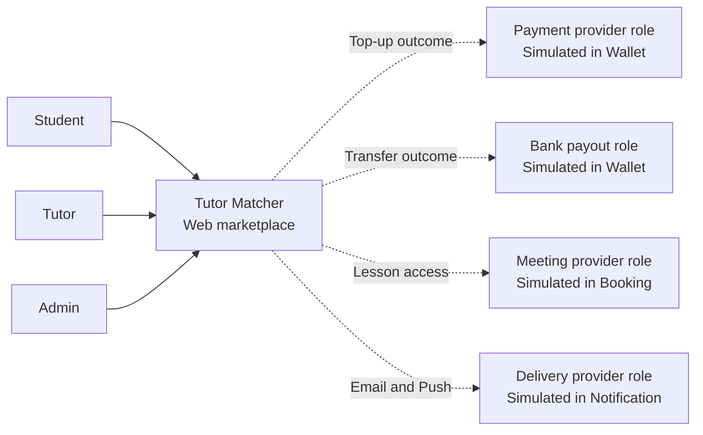
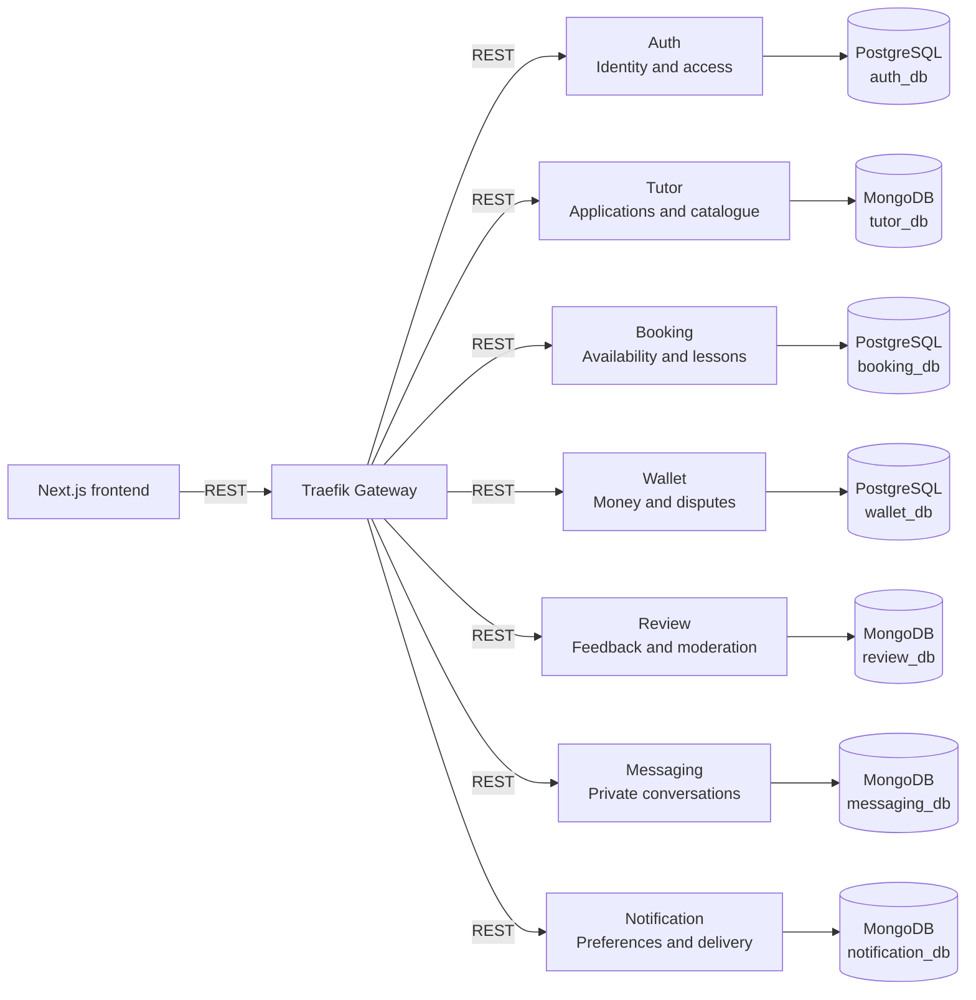
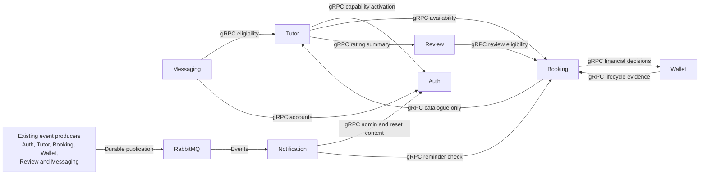
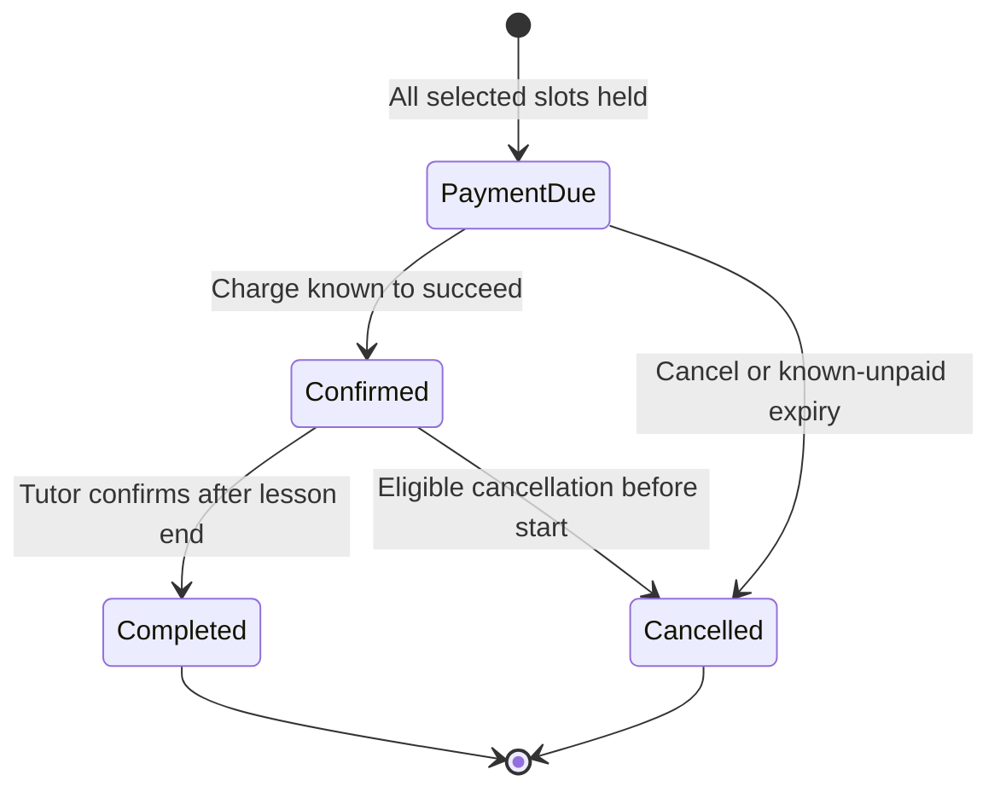
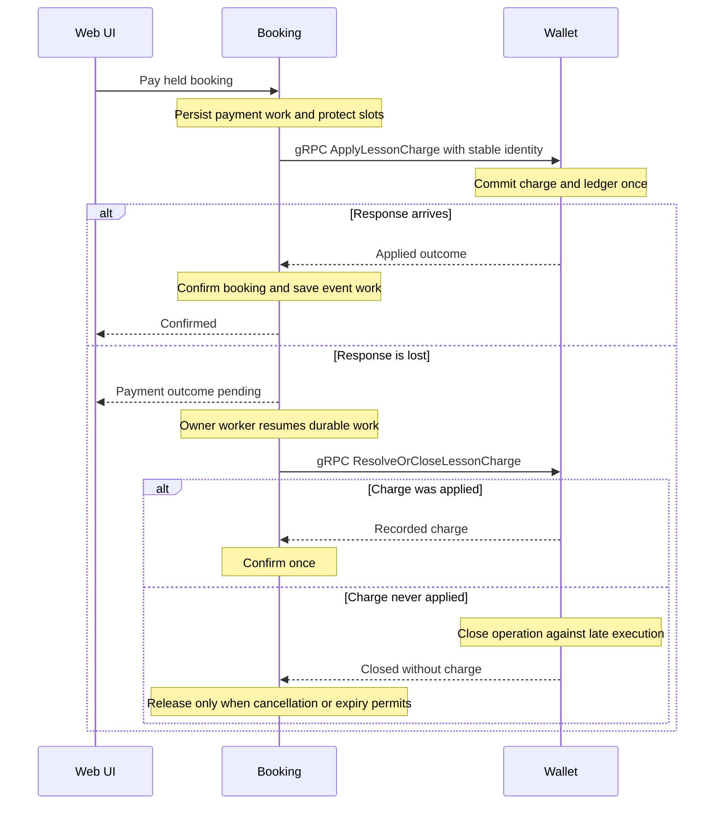
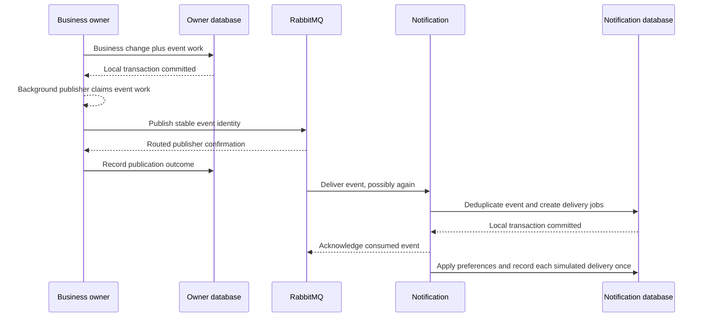
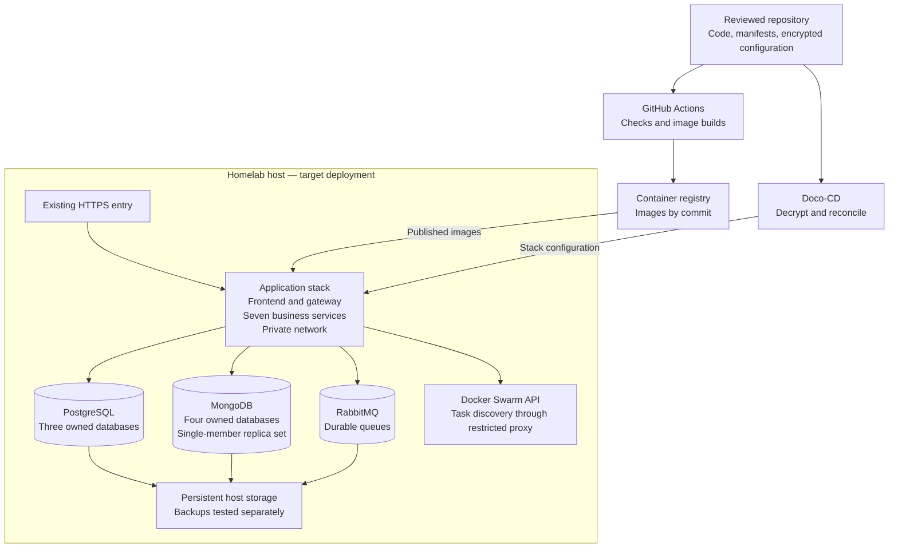

# Tutor Matcher system design

Status: Accepted target design. Recorded: 6 November 2026, Asia/Bangkok.

This design implements the [accepted requirements](requirements.md) for the four-person team and the 10 November delivery.
It preserves the existing stack and most service ownership. It does not claim that the current code or hosted deployment implements the target.
[ARCHITECTURE.md](../ARCHITECTURE.md) remains the current implementation snapshot. The [ADR index](adr/README.md) records decisions and their history.

## Goals and retained choices

Keep Next.js presentation separate from Express business services in TypeScript. Use Traefik with native Swarm discovery as the gateway, retaining REST, gRPC, RabbitMQ, npm workspaces, and service-owned data. [ADR-0029](adr/0029-traefik-swarm-discovery.md) records the 8 November replacement of Express gateway/Consul.
Retain hosted Swarm/Doco-CD, commit-traceable images, SOPS/age, and local Compose fallback. Providers remain simulated in both environments.
Use the [pinned monolith journeys][journeys] and existing policy evidence rather than redesigning navigation or business policy.

The focused changes are:

- Add the PDF's Review service and the newly agreed Messaging service.
- Move Booking alone to PostgreSQL. Retain MongoDB for Tutor and Notification, and use it for Review and Messaging.
- Replace partial slot updates and uncertain cross-service writes with local transactions and durable recovery.
- Save event work with business changes so a broker outage cannot silently lose required notifications.
- Apply the confirmed cancelled-booking dispute window in the requirements.

There is no separate Admin, Discovery, Meeting, Payout, Dispute, Settlement, or Scheduler service.
Admin pages call the service that owns each decision. Background work runs with its owner, rather than introducing another platform.
Exact routes, protobuf messages, event schemas, error codes, and shared monetary representations belong to step 3.
Durable work remains recorded after a process restart. Idempotent means retries do not repeat an operation's effect.

## System context

A C4 context view identifies the system, its users, and integration roles. Students, tutors, and admins use one web application.
Student and Tutor remain capabilities of the same account. Simulated providers do not replace the internal business rules or their failure handling.

The provider boxes are logical integration roles, not additional deployed services or live external integrations.
Their adapters run inside the owning services. The source [Tutor Matcher PDF](sources/tutor-matcher.pdf) describes the original provider roles.
The [course syllabus](sources/swarch-syllabus-2026-11-04.pdf) requires the context and container views. Instructor acceptance of provider simulation remains unconfirmed.

## Containers and data ownership

A C4 container is a runnable application or a data store. The frontend and gateway are separate containers.
Seven business services own their data. PostgreSQL and MongoDB engines can share infrastructure while keeping separate logical databases and access permissions.
No service reads another service's tables or collections, even when both databases run in one engine.

The view above emphasizes ownership. The following table defines interservice communication without adding every arrow to that diagram.
The gateway routes UI requests and checks identity. Business services own validation, permission checks, workflows, and state changes.
Names of capabilities below are conceptual operations, not frozen step-3 API names.

| Owner | Authoritative data and decisions | Collaborators |
| --- | --- | --- |
| Auth | Credentials, accounts, Student profile/onboarding preferences, sessions/reset tokens, current capabilities and restrictions, account audit | Tutor-authorized capability activation; Notification through events |
| Tutor | Profile drafts/versions, application review, public listing, subjects, approved tutor-to-account ownership | Auth for activation; Booking for availability; Review for public ratings |
| Booking | Canonical slots, holds, booking snapshots, lifecycle, meeting links, completion, durable payment/cancellation work, reminder schedule | Tutor for catalogue-only reads; Wallet for financial decisions; Notification through events |
| Wallet | Posted ledger/balances, reservations, top-ups, payment/refund attempts, booking financial records, pending earnings, clearing, disputes, payout accounts/attempts | Booking for authenticated lifecycle evidence and recovery; Notification through events |
| Review | One review per completed booking, tutor reply, flags, moderation audit, public rating summaries | Booking for completion/ownership eligibility; Notification through events |
| Messaging | Conversation participants, messages, read cursors, private inbox and thread state | Auth/Tutor for permitted participants; Notification through events |
| Notification | Preferences, accepted events, per-recipient/channel jobs, reminders awaiting dispatch, simulated delivery receipts | RabbitMQ; Booking for current reminder eligibility; simulated delivery adapter |

Review and Messaging receive their own MongoDB databases. This uses the existing document engine without sharing Tutor's private state.
Booking's database choice supersedes only the Booking part of the original MongoDB ADR. Wallet remains a separate owner and transaction boundary.
The [glossary](../GLOSSARY.md) defines account, booking, wallet, pending earning, and dispute meanings.

## Communication and query composition

The browser calls the gateway through the Next.js presentation layer. It does not call service ports directly or calculate authoritative money values.
Next.js can proxy requests and compose presentation, but it does not own booking, wallet, or permission rules.
The gateway remains a router and authentication entry point, rather than becoming the business workflow coordinator.

| Interaction | Retained or selected mechanism | Reason |
| --- | --- | --- |
| UI to gateway and public service operations | REST | Preserve the existing client-facing model and monolith journeys. |
| Tutor to Booking for availability | gRPC | Preserve a real gRPC collaborator in discovery and availability views. |
| Booking to Tutor for bookable subject details | gRPC, catalogue-only read | Avoid calling a profile operation that calls Booking back for availability. |
| Booking to Wallet for charge/refund/outcome resolution | Synchronous gRPC with durable recovery | Payment success must be known before confirmation. A timeout cannot be treated as a financial failure. |
| Producers to Notification | RabbitMQ events from durable outboxes | Delivery outages do not decide business success. |
| Tutor to Auth for capability activation | Idempotent gRPC with durable retry | Tutor owns the approval decision; Auth owns the account capability. |
| Review to Booking for eligibility | Read-only gRPC | A browser or client-supplied completion flag cannot authorize a review. |
| Other private domain lookups | gRPC | Auth lookup/admin/reset content, Tutor eligibility, Review summaries and Booking evidence/reminder checks. |
| Gateway introspection and owner-status polling | Private REST | Keep Gateway infrastructure separate from domain RPCs. |
| Scheduled work | Workers in the owning service claiming persisted work | Recovery survives restarts and does not need a new scheduler service. |

This collaboration view supplements the ownership view. The producer box groups existing services and is not an additional container.
The user selected all private domain collaborations on gRPC in step 3. [ADR-0028](adr/0028-private-domain-grpc.md) records this change. The target now has 20 RPCs, 86 public REST operations and eight private Gateway REST operations.

The [step-3 interface contracts](../contracts/README.md) now define the exact operation surface. The two Tutor/Booking arrows use different operations and do not recreate the current profile callback.

Tutor composes public catalogue, rating, and availability data through bounded batch reads where possible. Avoid a remote request for every result card.
Apply filtering and recommendation ordering before pagination, using the [reference discovery rules][journeys]. Do not paginate first and then filter away results.
Keep the quality target measurable across the complete search path, including collaborator latency.

Do not add Elasticsearch, Redis, a duplicated catalogue, or a new search service without measured need.
Rating and availability data remain owned by Review and Booking. Batch composition is the initial design, with bounded deadlines and explicit unavailable states.
Do not fabricate zero ratings or empty availability when a required collaborator fails. A successful booking always checks current eligibility and slot ownership.

## Identity permissions and tutor activation

Auth owns account identity, current account capabilities, and restrictions. Tutor owns the only tutor-application approval decision.
Tutor records link to the immutable Auth account ID, rather than treating a matching email as ownership.
There is no second approval workflow in Auth and no client-controlled publication or capability grant.

For protected requests, Traefik calls Auth's private `GET /internal/gateway/authorize` ForwardAuth endpoint. Auth verifies Gateway workload proof, the current browser session/account state, and the required capability before issuing the 60-second RS256 actor assertion with logical issuer `api-gateway`. Traefik removes the browser token and forwards the signed assertion with Gateway workload identity. Signature and expiry alone cannot enforce a recent suspension, so Auth checks current state at admission.
If current authorization cannot be established, reject the protected action. Public catalogue reads can remain available.
Strip and replace client identity headers. Internal operations require trusted workload identity and preserve the original actor for audit.
The [identity contract](../contracts/README.md#identity-capability-and-privacy) specifies how identity crosses each REST, gRPC, and event interface. No internal write operation is publicly routed.

Each service checks ownership and its domain permissions. Gateway authentication does not allow one user to edit another tutor, conversation, payout account, or booking.
Public Tutor responses exclude verification-document URLs. Admin workflows expose only the private data required for their authorized task.
Restrictions preserve paid bookings and financial records. They do not silently move money or erase evidence.
The user confirmed the [account lifecycle](../contracts/README.md#account-lifecycle) on 8 November 2026: password changes and resets revoke every session; name/email edits preserve sessions. Suspensions require manual admin restoration, bans are permanent for this delivery, and soft-deactivated accounts permit admin-only restoration. Restored accounts require fresh login; old sessions stay revoked. Auth commits credential/status changes and the required session revocation together. Preserve existing bookings, funds, account identity and audit history.

Tutor approval uses a recoverable activation workflow:

1. Tutor records the immutable admin decision and activation work in one local transaction.
2. After commit, Tutor requests the account capability from Auth using a stable operation identity.
3. Auth grants that capability once and records the outcome in its own transaction.
4. Tutor records activation and the unpublished listing, then makes completion of the approval visible.
5. If a response is lost, retry or resolve the same operation. Show activation as pending until it is known to finish.

No remote call runs inside a database transaction. No grant is issued before an approved application exists.
An approval response that is still activating must not pretend that tutor access already works. Workers resume interrupted activation after restart.
Already accepted recovery work uses its recorded authorization and service identity, rather than depending on an expired browser token.

## Local consistency and durable workflows

PostgreSQL transactions protect Booking's related slot, hold, booking, operation, and outbox records.
Use a canonical half-hour grid and unique tutor/start identity. Claim the full selected block or claim none.
Condition lifecycle transitions on the expected current state or revision. Cancellation, payment, expiry, and completion cannot independently overwrite each other.

Keep MongoDB for document-oriented owners. Configure the shared MongoDB engine as a persistent single-member replica set where transactions cover business records and outbox work.
MongoDB writes are atomic per document. An update across several documents is not automatically atomic. The selected transaction model requires compatible deployment configuration.
See [MongoDB atomicity](https://www.mongodb.com/docs/v7.0/core/write-operations-atomicity/) and [replica-set conversion](https://www.mongodb.com/docs/v7.0/tutorial/convert-standalone-to-replica-set/).

A one-member replica set is a transaction prerequisite in this design, not a database failover system.
The existing standalone Mongo container does not implement this target. Database and broker storage must persist across supported container replacement.
The actual configuration and any existing-data migration belong to implementation and deployment work.

### Booking and payment

Keep four business states: payment due, confirmed, completed, and cancelled. Technical operation state is separate from those user-facing meanings.
An uncertain payment, refund, or activation is pending work, not evidence that an operation failed.
The [shared schemas](../contracts/schemas/v1.json) define the interface enums and result shapes; internal storage can retain separate technical state.

Before sending a charge, Booking persists a payment operation and prevents a conflicting cancellation or expiry from releasing its slots.
Wallet records the operation identity, immutable inputs, and outcome. Duplicate calls return the recorded outcome, rather than moving money again.
Reusing an identity with different participants, amounts, or purposes is an error.

A lost response leaves the operation unresolved. Recovery must either find the applied charge or close the unexecuted operation so a late request cannot charge it.
An absent Wallet record alone is insufficient proof: the original request can still be in flight.
Closing must serialize with charge execution and leave a durable rejection of later execution under that identity.
Only after that terminal decision can Booking release slots or complete the appropriate confirmation/refund path.

The sequence omits gateway/authentication and local database participants to focus on the payment boundary.
No transaction spans Booking and Wallet. The [recovery contract](../contracts/recovery.md) defines this operation; the current charge API does not yet implement it.
Recovery keeps the financial result and booking result consistent after a timeout or restart.

Cancellation records the eligible actor, accepted quote, policy, and request time before calling Wallet. A later retry does not recalculate a different fee silently.
While an accepted cancellation is unresolved, reject conflicting lifecycle actions and in-app joining. Recovery continues the recorded cancellation decision.
Known unpaid cancellation moves no money. Paid cancellation records one refund result before releasing slots and finalizing the cancelled state.
Student cancellation reopens eligible free slots. Tutor cancellation closes freed slots and records the reason.
Review eligibility follows Booking completion. Refund/dispute status remains separately visible instead of silently changing lesson history.

### Completion settlement and disputes

Booking owns whether the assigned tutor can complete the lesson. It records completion and durable work that reports the immutable confirmation time to Wallet.
Wallet owns the paid amount, cumulative refunds, pending earning, clearing deadline, dispute hold, and settlement result for that booking.
A delayed completion handoff cannot lose earnings or replace the original confirmation time with the later retry time.

Opening a dispute, clearing an earning, and deciding a remedy lock the same Wallet financial record.
If dispute opening commits first, clearing sees the hold. If clearing commits first, the claim cannot be reported as successfully opened.
A dispute opened before tutor completion remains effective when completion later arrives.
The row-lock mechanism is local to Wallet's PostgreSQL database. See [PostgreSQL locking](https://www.postgresql.org/docs/16/explicit-locking.html).

The 24-hour clearing period starts at tutor-confirmed completion. A rejected dispute releases its hold without bypassing that deadline.
An approved dispute refunds the remaining paid amount once and removes the refunded lesson's pending earning in the same financial transaction.
Use distinct operation identities for cancellation and dispute remedies. The current one-refund-per-booking shortcut cannot handle a 70% refund followed by the remaining amount.
Enforce the cumulative original-payment cap under the shared financial lock. Preserve completed ledger entries and write compensating movements.

Cancelled bookings never receive tutor confirmation or earnings clearing. Their remaining payment has the separately agreed claim window in the requirements.
Fully refunded bookings have no remaining financial claim. No post-settlement claim or post-payout clawback is introduced by this design.
Financial policy values remain in [requirements.md](requirements.md), rather than being copied into a competing specification.

### Top-ups payouts and simulated providers

Wallet owns top-up and payout attempts. Each provider adapter accepts a stable operation identity and supports controlled success, failure, and unresolved outcomes.
For payouts, reserve available funds before requesting the simulated transfer. Keep the reservation while the result is unknown.
Success posts the payout once and consumes the reservation. Definitive failure releases it without inventing a completed payout movement.
Never repeat a transfer merely because its first response was lost.

Booking owns meeting provisioning work and the generated URL separately from the tutor override. A provider failure leaves a paid booking confirmed.
Notification owns simulated Email/Push delivery. Provider receipts and controls must identify themselves as demonstrations.
Adapters are internal implementations, not new services or HTTP endpoints for arbitrary public callbacks.

Demo outcome controls must be restricted to authorized synthetic operations. A student cannot forge another user's confirmation or mark money paid through an ordinary public field.
The hosted application uses production builds with explicit demo-provider configuration. Do not enable simulation by pretending the deployment is a development build.
Real accounts, real payments, and live provider credentials are outside this delivery.

## Recoverable events and scheduled work

An outbox is event work saved with a business change. Each producer writes it in the same local transaction as the decision that requires notification.
Generate and retain the event identity with that transaction. An API retry must not create a new event for an already completed action.
Workers in the owning service publish after commit and retry under the same identity. They do not hold a database transaction open while contacting RabbitMQ.

Declare required durable queues and bindings before marking an event successfully routed. Publisher confirms alone do not prove that a message reached a required queue.
Handle unroutable messages and uncertain confirmations as recoverable work. Reconnect and retry after broker failure.
Persist RabbitMQ data and stable queue identities. See [publisher confirms](https://www.rabbitmq.com/docs/confirms) and the [RabbitMQ reliability guide](https://www.rabbitmq.com/docs/reliability).

Notification acknowledges only after it durably accepts the event and jobs. Delivery runs independently per event, recipient, and channel.
Evaluate current preferences at dispatch. A single event can notify several recipients and both Email and Push without conflating their outcomes.
The inspectable simulated receipt is the delivery effect. Its unique identity prevents repeated effects after recovery.
This does not claim exactly-once external email delivery or extend that guarantee to a future real provider.

Booking persists reminder deadlines and validates lesson state before producing due reminders. Notification checks current Booking eligibility before dispatching a delayed reminder.
Skip reminders for cancelled, completed, started, or obsolete-schedule lessons. Retries must not send duplicate reminders.
Workers claim jobs with durable leases or equivalent concurrency control. A process crash releases work for recovery without allowing a stale worker to overwrite a newer result.

Auth reset expiry, Booking hold expiry/meeting work/reminders, Wallet settlement/provider recovery, and producer outbox delivery stay with their owners.
Do not use in-memory timers as the only record of future work. Reconcile due work after restart.
No separate queue product or scheduler service is required.

## Discovery reviews messaging and administration

Review verifies the completed booking and student ownership against Booking before publication. Enforce one review per booking and one tutor reply.
Record flag and moderation decisions locally. Update public rating summaries under the same Review decision, then expose them to Tutor's query composition.
Hide/remove suppresses the whole public review, its reply, and its rating contribution. Do not leave a cached public average that still includes the removed rating.

Messaging validates ordinary student–tutor participants on the backend. Admin messaging is an explicit privileged workflow, not permission to read every private conversation.
Store messages separately from an unbounded conversation array. Retain participant and read-cursor ownership independently of notification delivery status.
Persist a sent message and its notification work together. A delivery outage must not lose an accepted message.

Admin application/listing work goes to Tutor. User restrictions and account search go to Auth. Financial disputes go to Wallet and review moderation goes to Review.
Keep those pages in the same frontend and route through the existing gateway. There is no Admin database containing copies of every business record.
Read-only cross-owner views compose service results without introducing cross-database access.

## Deployment and operational limits

The diagram is a deployment target, not a report of server access or a successful rollout. The actual HTTPS entry and host capacity require implementation verification.
Only the web entry is public. The frontend reaches the gateway, and the gateway reaches private services.
Database, broker, registry management, and service ports must not become public application interfaces.

Use separate local and hosted manifests. Images are built in CI and referenced by a traceable revision. Keep production secrets encrypted in Git.
Persist PostgreSQL, MongoDB, and RabbitMQ storage. A one-time initialization/migration step is deployment work, not an additional business service.
Pin stateful workloads to storage-owning placement unless shared storage is explicitly designed and tested.

Traefik discovers opt-in Swarm services/tasks through a restricted Docker API proxy; services do not register themselves. Local Compose uses the Docker provider. Public routes stay in an explicit shared allowlist, while labels supply private backend ports and active readiness checks.
Use the intended private overlay network for backend addresses. Keep the Docker socket out of Traefik and application containers.
Traefik retains its last successfully discovered configuration if the Docker API is unavailable, while active backend checks continue. A known pool with no healthy backend returns 503. Detection has delay, new tasks remain unknown during an API outage, and gateway startup requires discovery.
Service-to-service REST/gRPC calls retain configured service DNS. [ADR-0029](adr/0029-traefik-swarm-discovery.md) supersedes the old Consul/fixed-name gateway fallback. The [hosted backend manifest](../infra/hosted/README.md) is an implementation step, not evidence of target deployment completion.

Tutor replicas remain stateless and can scale independently. Database-backed job claims make owner workers safe when an application has several replicas.
The gateway, Auth, database engines, broker, discovery API, and physical host remain potential failure points. This is not a highly available deployment.
Keep the full local Compose demo rehearsed in case hosted access fails.

Use persisted synthetic fixtures, not a destructive database reset on every start. Define backups for each owned store and restore into an isolated environment.
After restoration, check financial history and resume recorded operations through the same recovery paths. Never declare a missing outcome failed solely because a process restarted.
Record versions, resource limits, dataset, and environment with load-test evidence.

## Requirement coverage and validation

| Requirement group | Main owner and collaborators | Required design evidence |
| --- | --- | --- |
| AUTH-01–AUTH-05, SUP-04 | Auth; gateway and owning services | Current permission checks, ownership, controlled admin provisioning, reset/session behavior, account audit. |
| UC-01 | Tutor and Auth | Immutable review, recoverable capability activation, private documents, visible pending activation. |
| UC-02 | Tutor and Booking | Publication/revision ownership, subject snapshots, unique canonical slots and lock-aware edits. |
| UC-03 | Tutor, Booking, Wallet, Review | Batch discovery composition, atomic slot hold, durable charge/reconciliation and immediate known-success confirmation. |
| UC-04 | Wallet | Confirmed-once credit, failed/unknown outcomes, private simulated-provider controls. |
| UC-05 | Booking, Wallet, Review | Meeting recovery, tutor completion, durable financial handoff, clearing and review eligibility. |
| UC-06 | Booking and Wallet | Quote-bound cancellation, refund recovery, actor-specific slot release, immutable history. |
| UC-07 | Wallet | Tutor-only owned accounts, reserved funds, provider resolution, idempotent payout. |
| UC-08 | Review; Booking and Tutor | Completion eligibility, unique review, moderation audit and correct public summaries. |
| UC-09 | Wallet; Booking | One financial gate for disputes/clearing, refund cap, approved cancelled-booking window. |
| SUP-01 | Messaging; Auth/Tutor and Notification | Private participant checks, durable message acceptance, unread state and notification work. |
| SUP-02–SUP-03, Q-06 | Notification and all producers | Durable outbox, routing, durable jobs, preferences, unique per-channel simulated effects. |
| Q-01–Q-02, Q-05 | All owners | Concurrent transitions, stable identities, monetary/time contracts, unauthorized action checks. |
| Q-03–Q-04, C-05–C-07 | Tutor, gateway, discovery collaborators, infrastructure | Comparable scaling and stress tests, failure exercises, measurements and risk matrix. |
| Q-07–Q-10, C-08–C-12 | Deployment and presentation work across owners | Restart/restore, encrypted configuration, quality commands, C4/sequence/deployment views and live rehearsal. |
| C-01–C-04, C-13 | Whole system and submission evidence | Nine working UI journeys plus authentication, actual protocols/stores/discovery, retained contribution and progress evidence. |

Validate the design through interrupted-work scenarios, not only successful requests. In particular, lose a charge response, restart between local commits, delay completion delivery, and race a dispute against clearing.
Also exercise a late charge after an operation is closed, partial cancellation followed by a dispute, redelivered notifications, and a recent account ban with an unexpired token.
These are acceptance obligations for implementation. Document rendering does not count as passing those runtime checks.

## Interface design handoff

Step 3 is recorded in the [interface contracts](../contracts/README.md). The table below remains the checklist for that contract set before implementation starts.
Keep these ownership and recovery decisions fixed unless another explicit change is recorded.
Use synthetic examples and preserve the pinned monolith UI journeys while defining the gateway mapping.

| Contract concern | Required step-3 result |
| --- | --- |
| Public REST and internal operations | Resource ownership, route mapping, request/response shapes, error meanings, current authorization, and private/public separation. |
| Private domain gRPC | Twenty methods across Auth, Tutor, Booking, Wallet and Review. Typed messages, caller allowlists, deadlines, presence and error semantics. |
| Identifiers and revisions | Stable user/tutor/subject/slot/booking identities, expected revisions, actor identity, and cross-service references without foreign database access. |
| Money and time | Decimal representation and rounding, quote identity, UTC timestamps, Bangkok display, deadline boundaries, and authoritative request/confirmation times. |
| Durable operations | Identity reuse rules, immutable inputs, queryable outcomes, close/fence semantics, concurrent transitions, and retry/timeout behavior. |
| Events and queues | Event identities, versions, required recipients/subscriptions, ordering expectations, durable routing, and per-channel delivery identities. |
| Recovery and workers | Lease/fence semantics, pending-result visibility, reconciliation capabilities, failure fixtures, and evidence that each side resumes safely. |
| Simulated providers | Private outcome controls, stable provider receipts, authorization, explicit demo configuration, and success/failure/unknown examples. |

The diagrams in this document are the editable source. Corresponding [rendered views](design/README.md) are generated from these blocks for review.
They must be regenerated when a source diagram changes. The [interface contract set](../contracts/README.md) is the implementation handoff; it does not claim runtime acceptance.

[journeys]: https://github.com/Azther0z/tutor-matcher/blob/ce3ec82672d7dac5da8b846ecdb6725dcc7e5ca1/docs/user-journeys.md
